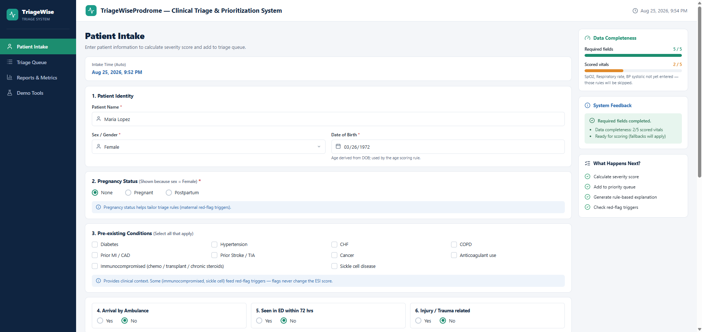
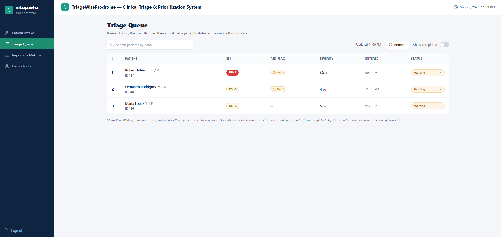
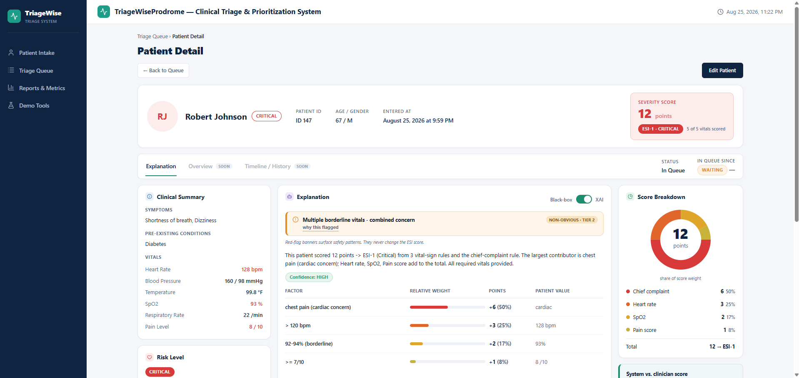
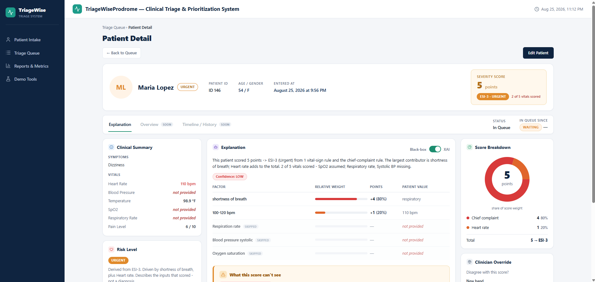
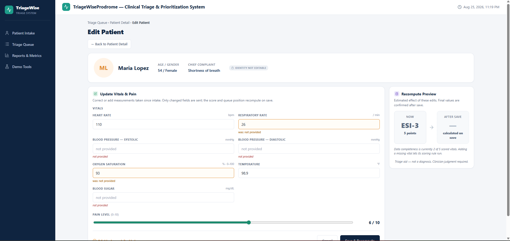
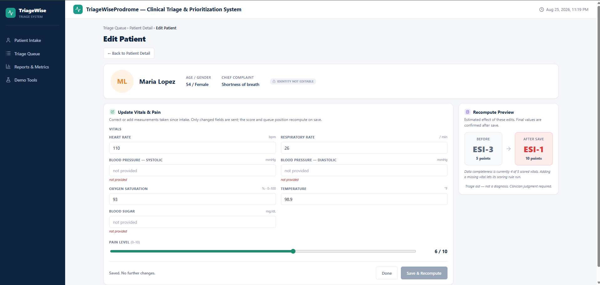
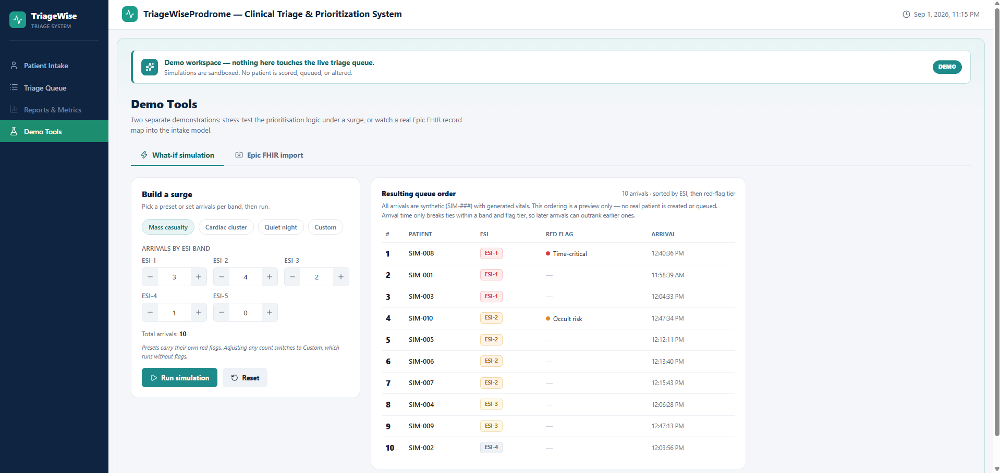
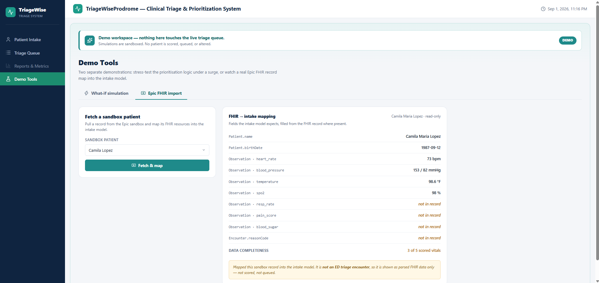

# TriageWiseProdrome · [](https://github.com/NvyGreen/TriageWiseProdrome/actions/workflows/backend-tests.yml) · [](https://github.com/NvyGreen/TriageWiseProdrome/actions/workflows/frontend-checks.yml) · [](https://github.com/NvyGreen/TriageWiseProdrome/actions/workflows/e2e-tests.yml)

A rule-based clinical triage and prioritization engine. It takes an emergency-department intake, assigns an ESI-style acuity level from transparent weighted rules, raises non-obvious red flags, and orders patients in a priority queue — while keeping every decision explainable and leaving final judgment with the clinician.

> Simplified and educational. Not clinically validated. It explains and prioritizes; it does not diagnose.

[triage-wise-prodrome.vercel.app](https://triage-wise-prodrome.vercel.app)

## Problem

In an emergency department, every minute matters. Doctors and nurses need to quickly identify which patients need urgent care.

However, existing triage tools have two main limitations.
- Some use complex AI/ML models that give a risk score but cannot clearly explain why.
- Others use simple rules or checklists that are easy to understand but may miss how multiple symptoms and warning signs work together.

This can be dangerous because some seriously ill patients may not show obvious warning signs at first. For example, an older adult may have unusual symptoms, a newborn may have a fever, or a patient may be developing shock even when their vital signs seem almost normal.

The goal is to build a triage tool that considers multiple warning signs together, clearly explains why a patient may need urgent attention, and helps clinicians make informed decisions without replacing their judgment.

## Solution

TriageWiseProdrome uses clear, weighted rules to estimate how urgently a patient needs care instead of relying on a black-box AI/ML model. Each score comes with an explanation showing which rules contributed to it and how the patient's actual symptoms or vital signs affected the result.

When information is missing, the system lowers its confidence rather than guessing. It also has a separate warning system to flag patients who may be seriously ill even when their symptoms or vital signs appear normal. These warnings do not change the patient's score but help clinicians recognize situations that may need closer attention.

The system places patients in a queue based on their scores and explains why each patient is ranked where they are. The rules, thresholds, and warning patterns are stored in a database, making them easier to update without changing the code. Clinicians can also override the system's recommendations whenever needed.

When a patient is registered, the system immediately confirms that the request has been received and is pending scoring. It calculates the patient's score in the background while the screen checks for the result. This allows the intake process to continue without waiting for the calculation to finish.

## Features

- **Transparent ESI scoring** — weighted vital and complaint rules map to an ESI level (1–5), with ESI-3 refined by expected resource use.
- **Honest missing-data handling** — per-rule fallbacks, data-completeness tracking, and a confidence downgrade instead of silent guessing.
- **Red-flag detection** — structured AND/OR trigger trees catch occult presentations, maternal risk, febrile neonates, and early shock. Flags reorder the queue and surface a banner; they never change the score.
- **Priority queue** — a Postgres-backed queue ordered by `(ESI band, flag tier, arrival time, intake id)`, re-ranked as records are updated or overridden.
- **Structured 4-part explanation** — every scored patient carries a named-driver breakdown (factor, threshold, actual value, weighted contribution), a data-completeness summary, an explicit gap acknowledgement (what the engine can't see), and a standing clinician-judgment disclaimer.
- **Plain-language summaries** — a narrative lede and a short risk-level blurb are composed from the stored breakdown at read time, deterministically.
- **Presentation-mode toggle** — the same scored case renders two ways: full explanation (XAI) or score-and-level only (black-box), with the reasoning stripped at the response layer so it never leaves the server.
- **Dual-score disagreement** — when a clinician supplies their own ESI, the system surfaces both side by side and names the drivers that account for the gap.
- **Clinician override** — the system's ESI can be overridden with a structured reason; the override is logged, re-orders the queue by the clinician's value, and is recorded for later review.

## Architecture & tech stack

A FastAPI web app accepts intakes and serves reads; a separate scorer process does the scoring. Both share PostgreSQL, with a React frontend on top.

```
POST /patients ──> TriageService.submit_intake ──> intake_record (scoring_status='pending')
                                                              │
                        ┌─────────────────────────────────────┘
                        │  app/scorer.py  (separate process)
                        │  claims one row: FOR UPDATE SKIP LOCKED
                        ▼
                   TriageService.score_intake
                        ├──> ScoringEngine ──> RedFlagLayer ──> patient_severity
                        ├──> ExplanationBuilder ──> ai_explanation
                        └──> triage_queue row        (all in one transaction)

GET /queue ──> single indexed read of triage_queue, ordered by
               (esi_band, flag_tier, arrival_time, intake_id)
```

- **ScoringEngine** — produces a `SeverityResult` (score, ESI, drivers, data-quality signals) from an intake. The red-flag layer is injected into `score()`, so the engine attaches flag metadata to the result without owning flag logic — and the flag layer can be swapped or mocked independently. Flags never change the numeric score.
- **RedFlagLayer** — evaluates each rule's condition tree and returns fired triggers. Read-only with respect to the score.
- **Scorer (worker process)** — claims pending intakes with `FOR UPDATE SKIP LOCKED`. Claim, score, and status write share one transaction: a crash rolls back and the row stays `pending` for the next pass, so there are no stuck rows and no recovery job. The claim mechanism lets several scorers run concurrently without coordination, so throughput can be increased by starting more of them. The deployment runs a single scorer; there is no autoscaling.
- **Queue** — persisted in `triage_queue`, ordered by a composite index on `(esi_band, flag_tier, arrival_time, intake_id)`. Rank is based on the position each record is ordered in.
- **TriageService** — coordinates the services and owns persistence and event logging, but not the scoring workflow — the scorer does.

Reference data (scoring weights, ESI bands, red-flag patterns, vital ranges, condition base rates) is loaded from CSV into lookup tables and read at runtime — changing a weight or a threshold needs no code change.

**Stack:** Python · FastAPI · SQLAlchemy · Alembic · Pytest · PostgreSQL · React · honcho (web + worker) · deployed on Vercel.

## Engineering & quality

- **Config-driven, not hardcoded** — scoring weights, thresholds, complaint tiers, and red-flag patterns live in reference tables read at runtime; re-tuning is a data change, not a code change.
- **Structured red-flag evaluation** — trigger patterns are stored as machine-evaluable JSON condition trees (AND/OR groups, field checks, helper calls) rather than parsed prose, so rules can be added or edited as data.
- **Clean separation of concerns** — scoring, red-flag detection, and queueing are independent services; the red-flag layer is injected into scoring rather than hardwired, so it can be swapped or mocked.
- **Consistent API error contract** — every error returns a structured envelope with a stable code (`invalid_input`, `not_found`, `duplicate_request`, `unscoreable`, `internal_error`), a message, and a request id.
- **Idempotent writes** — mutating endpoints require an idempotency key so retries don't double-submit.
- **Tested and CI-gated** — three workflows run on every PR: the backend Pytest suite against a live PostgreSQL service (fixture-driven, covering scoring, ESI refinement, missing-data fallbacks, red-flag evaluation, the explanation/lede/dual-score/base-rate rendering, override logging, and input validation, behind an 90% branch-coverage gate), frontend lint + production build, and an E2E suite against a provisioned database. `main` is protected on the backend and frontend checks; E2E runs on every PR but is advisory for now.

## Validation and Results

### 1. Real Patient Outcome Validation

The system was tested on two datasets of 500 patient records each, derived from MC-MED. The goal was to evaluate how well its triage scores aligned with actual patient outcomes, including hospital admission, ICU admission, and discharge.

**Key results:**
| Metric | Balanced Dataset | Representative Dataset |
| ------ | ---------------- | ---------------------- |
| Exact triage-level agreement | 40.2% | 32.4% |
| Under-triage rate | 31.6% | 46.2% |
| Outcome AUC | 0.853 | 0.664 |

**What do these results mean?**  
Exact agreement: How often the system assigned the same triage level as the outcome-based comparison.  
Under-triage: Cases where the system assigned a lower priority than the patient's outcome suggested was appropriate. This is particularly concerning because it can delay urgent care.  
Outcome AUC: How well the scores distinguish patients who are more likely to be admitted from those who are less likely to be admitted. Higher values indicate better discrimination.
Full numbers and limitations: [`scoring_validation.md`](docs/validation/scoring_validation.md).

### 2. Clinician Validation

The system was tested on a separate set of 20 patient cases. Its triage assessments were compared with clinician-assigned Emergency Severity Index (ESI) levels.

Results: 18 out of 20 cases matched, achieving 90% agreement.

The two cases where the system disagreed with clinicians were reviewed:  
Case 1: Heavy bleeding after childbirth. The system assigned ESI-4, while the clinician assigned ESI-2. The system's red-flag mechanism detected the risk and moved the patient ahead of other ESI-4 patients in the priority queue. However, it did not change the patient's ESI score, so the system's assigned triage level still differed from the clinician's assessment.  
Case 2: Newborn's vital signs assessed using adult standards. The system assigned ESI-1 to a 20-day-old newborn, while the clinician assigned ESI-2. Because the system used adult vital-sign thresholds instead of age-specific ranges, it interpreted the newborn's vital signs as more abnormal than they were. This led to a higher urgency level than the clinician assigned. Although this was a scoring error, it resulted in over-triage rather than under-triage.  

What this tells us: The system matched clinician assessments in 18 of the 20 cases, but the two disagreements revealed important areas for improvement. Case 1 highlighted the difference between the assigned ESI score and the priority queue position. Case 2 showed the need to adjust vital-sign thresholds for different age groups, especially newborns and children.

Because the test included only 20 cases, the 90% agreement is an encouraging preliminary result, not proof of clinical accuracy.

Documented age-calibration limitation: [`validation_dataset_20.md`](docs/validation/validation_dataset_20.md).

### 3. Overall Findings

The two studies measure different aspects of performance:
- Patient outcome validation examines how well the scores align with actual patient outcomes.
- Clinician validation examines how closely the system's assessments match clinicians' judgments.

Together, the results show that the system has potential, but also has important limitations, particularly around under-triage and age-specific scoring.

### 4. Detailed Validation Reports
[Scoring validation results and limitations](docs/validation/scoring_validation.md)  
[20-case clinician validation](docs/validation/validation_dataset_20.md)

## Security

- **Allowlist-validated dynamic field access** — the red-flag engine resolves field names supplied by stored condition trees via `getattr`. Each name is validated against the intake table's real columns before access, so a malformed or malicious tree can't reach arbitrary attributes.
- **Locked-down CORS** — restrict allowed origins to the known frontend rather than a wildcard.

## Screenshots & demo

### Patient Intake


### Triage Queue


### Patient Detail + Explanation



### Update Patient



### Demo Screens



## Getting started

### Prerequisites

- Python 3.12+
- PostgreSQL running locally
- Node.js (for the frontend)

### Backend setup

```bash
cd backend

# create + activate a virtualenv, then:
pip install -r requirements-dev.txt

# configure your environment
cp .env.example .env        # then edit DB_NAME, DB_USER, etc.

# create the schema
alembic upgrade head

# load reference data (scoring rules, red-flag rules, ESI bands, vital ranges, condition base rates)
python -m scripts.load_reference_data

# Seed demo patients (optional)
python scripts/seed_demo_patients.py

# run the API + scoring worker
honcho start -p 8000
```

The API serves at `http://localhost:8000`. Interactive docs at `/docs`.

### Frontend setup

```bash
cd frontend
npm install
cp .env.example .env        # VITE_API_BASE_URL — point at the backend
npm run dev
```

### Running tests

```bash
cd backend
pytest
```

### Running the E2E suite

The browser tests in `e2e/` drive the real frontend against the backend, so they
have extra prerequisites and their own dependency lock. They run in CI via
`e2e-tests.yml` on changes to `backend/`, `frontend/`, or `e2e/` — the separate
lock keeps Playwright out of the *backend unit* CI install, which never needs it.

Prerequisites: PostgreSQL running, `backend/.env` present, and Node available (the
fixtures shell out to `npm run dev`). The suite provisions its own
`<DB_NAME>_e2e` database (created, migrated, and seeded automatically).

```bash
cd backend
pip install --require-hashes -r requirements-e2e.txt   # Playwright + pytest-playwright
playwright install chromium                             # browser binary (not a pip package)
pytest ../e2e
```

## Branching Strategy

**GitHub Flow**

- `main` always stays working
- Make a branch per requirement/task: `feature/scoring-engine`, `fix/esi-refinement`
- Open a PR to merge back
- Protect `main`: no merge unless the required checks pass (backend Pytest + frontend lint/build). E2E runs on every PR but is not yet required.

## Commit Message Format

```
type(scope): short summary

optional body explaining why
```

- **Types:** feat, fix, test, docs, refactor, chore
- **Subject:** imperative mood, ~50 chars, lowercase, no trailing period
- **Body:** only when the *why* isn't obvious; may reference requirement IDs

Ex: `feat(scoring): add ESI-3 resource refinement`